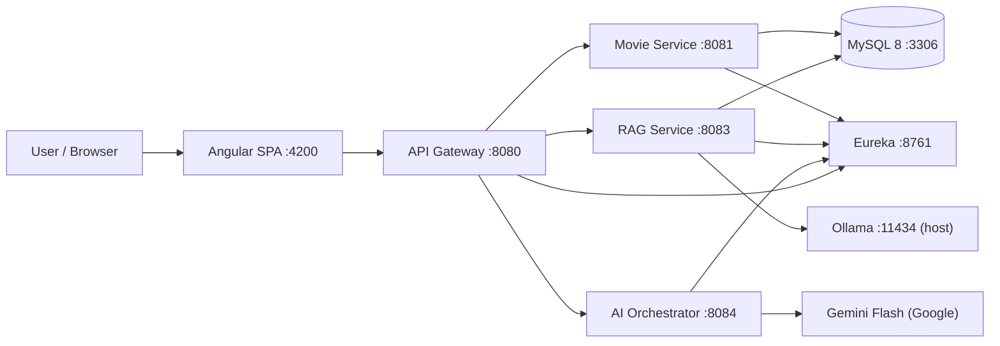
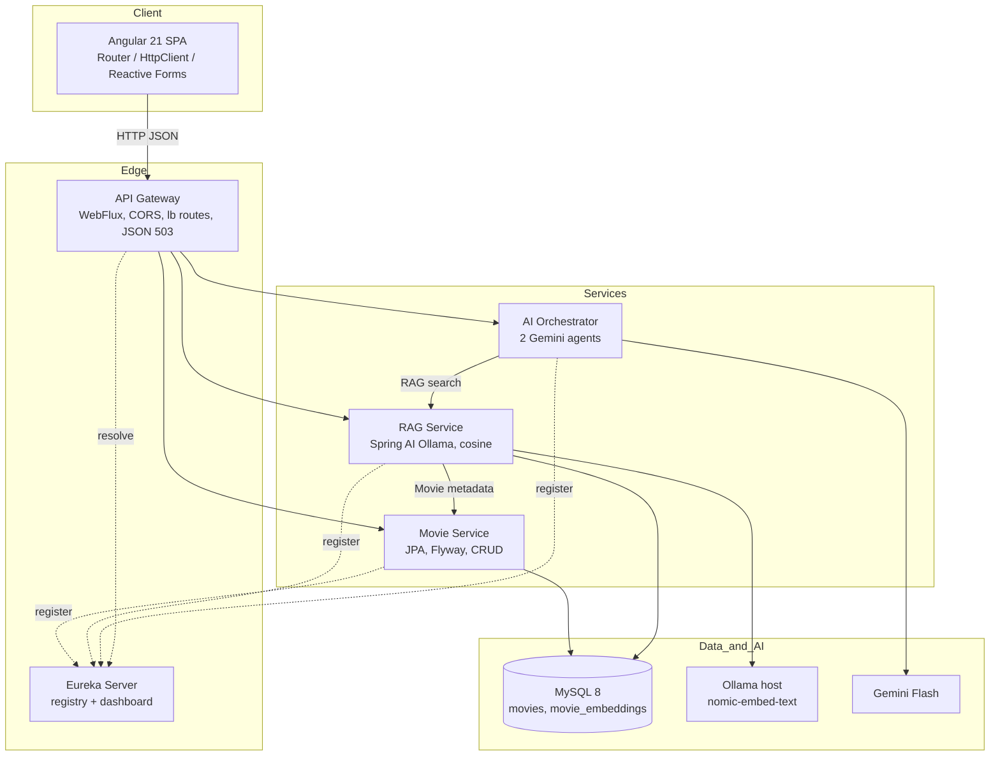
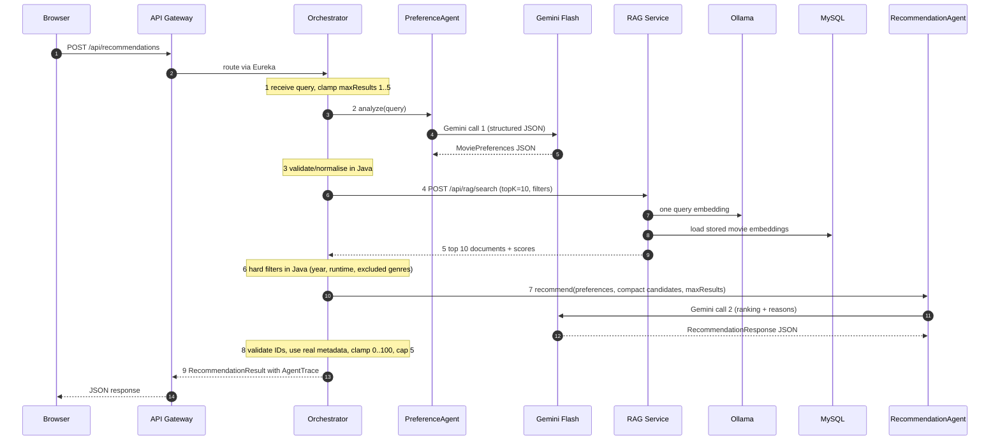
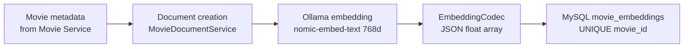
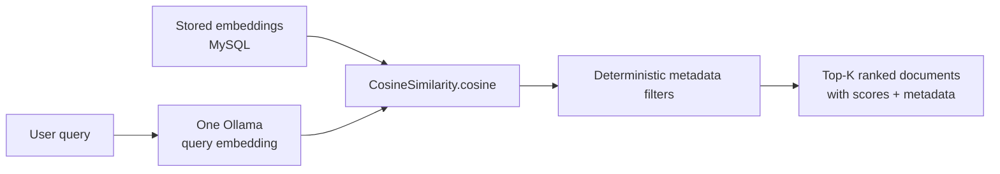

# CineMind AI — System Document

> **System Design & Specification** for CineMind AI, a microservices-based AI
> movie recommendation platform.
>
> Companion documents: [`SETUP.md`](SETUP.md) (installation) and
> [`README.md`](../README.md) (quick reference).

| Field | Value |
| --- | --- |
| Document | System Design & Specification |
| System | CineMind AI |
| Version | 1.0 (MVP) |
| Status | Implemented; integration-verified (see §16) |
| Scope | 5 Spring Boot services, Angular SPA, MySQL, Eureka, Ollama, Gemini Flash |
| Audience | Architects, backend/frontend engineers, reviewers, operations |

---

## 1. Purpose and scope

**Goal:** let a user describe a film in natural language and receive a small
set of explained movie recommendations, produced transparently by two
specialised AI agents working over a real, locally-stored movie catalogue.

**In scope:** service discovery, API gateway, movie CRUD, local
embedding-based retrieval (RAG) in MySQL, two-agent orchestration with Gemini
Flash, an Angular UI that displays real results and the real execution trace,
and Docker Compose deployment.

**Out of scope (MVP):** authentication/authorisation, user accounts,
watchlists, ratings by users, a vector database, streaming chat, autonomous
agent loops, multi-LLM routing, cloud deployment (Kubernetes), and a
production-scale (100–500 film) dataset importer.

---

## 2. System overview



**Key design decisions**

| Decision | Rationale |
| --- | --- |
| One logical service per bounded capability | Independent build/deploy; no shared library |
| Eureka + `lb://` routing | No hardcoded downstream hosts/ports |
| MySQL `LONGTEXT` JSON vectors + Java cosine similarity | Avoids PostgreSQL/pgvector/Redis/Chroma/Pinecone; portable |
| Exactly two agent classes, deterministic Java orchestration | No LangChain4j/CrewAI/Kafka; predictable and credit-efficient |
| Flyway owned by Movie Service only | Single schema authority; RAG sets `flyway.enabled=false` |
| Angular reads the Gateway only | No API keys in the browser |

---

## 3. Requirements

### 3.1 Functional requirements

| ID | Requirement |
| --- | --- |
| FR-01 | Register/discover all services via Eureka; expose a dashboard |
| FR-02 | Route `/api/movies/**`, `/api/rag/**`, `/api/recommendations/**` through one Gateway with CORS |
| FR-03 | Provide movie CRUD, paginated listing, title search and metadata filters |
| FR-04 | Build a concise text document per movie (title, overview, genres, year, runtime, keywords) |
| FR-05 | Generate embeddings with local Ollama `nomic-embed-text` (768 dims) and store them in MySQL |
| FR-06 | Index only new/updated movies; support forced re-index; never regenerate on search |
| FR-07 | Retrieve top-K (default 10) movies by Java cosine similarity with metadata filtering |
| FR-08 | Agent 1 extracts structured preferences (genres, mood, similarTo, min year, max runtime, excluded genres) |
| FR-09 | Agent 2 ranks retrieved candidates and writes short explanations; max 5 results |
| FR-10 | Never invent movie IDs/titles/years/metadata — only candidates from retrieved context |
| FR-11 | Orchestrate the fixed 9-step workflow and return an execution trace |
| FR-12 | Angular shows real recommendations, similar movies, extracted preferences and the real trace |
| FR-13 | Graceful degradation when Ollama or Gemini is unavailable |

### 3.2 Non-functional requirements

| ID | Requirement |
| --- | --- |
| NFR-01 | Java 17, Spring Boot 3.5.x, Spring Cloud 2025.0.x, Spring AI 1.x — all BOM-aligned |
| NFR-02 | At most **2 Gemini calls** + **1 Ollama query embedding** per normal recommendation |
| NFR-03 | No automatic retries (`spring.ai.retry.max-attempts: 1`); no loops |
| NFR-04 | DTOs only at API boundaries; constructor injection; global exception handlers |
| NFR-05 | Flyway migrations; `ddl-auto: none` in production |
| NFR-06 | All automated tests mock LLM/embedding clients — zero credits consumed |
| NFR-07 | Responsive dark UI, loading/error/empty states, no hardcoded recommendations or statuses |
| NFR-08 | Health checks + readiness ordering in Docker Compose |
| NFR-09 | No secrets committed; API keys only in backend env vars |

---

## 4. Architecture

### 4.1 Container view



### 4.2 Component responsibilities

#### Discovery Server (`discovery-server`, :8761)
`@EnableEurekaServer`; standalone (does not register/fetch itself); dashboard at
`/`; self-preservation off, 5 s eviction for development.

#### API Gateway (`api-gateway`, :8080)
Reactive WebFlux (`spring-cloud-starter-gateway-server-webflux`, **no MVC**).
Java `RouteLocator` with `lb://MOVIE-SERVICE`, `lb://RAG-SERVICE`,
`lb://AI-ORCHESTRATOR`; auto discovery locator disabled so only three routes
are exposed. `CorsWebFilter` for the Angular origin. Custom
`ErrorWebExceptionHandler` returns structured JSON 503 for downstream failure.
Stateless; no authentication yet.

#### Movie Service (`movie-service`, :8081)
`controller → service → repository` with JPA entity `Movie`, DTOs
(`MovieRequest`, `MovieResponse`, `MovieFilter`, `PagedResponse`), global
exception handler, Jakarta validation. Pagination (size ≤ 100), whitelisted
sort fields, dynamic `Specification` filters. Owns Flyway V1/V2.

#### RAG Service (`rag-service`, :8083)
`EmbeddingService` (Spring AI `EmbeddingModel`, dimension validation),
`MovieDocumentService`, `MovieIndexingService`, `MovieRetrievalService`,
`MovieEmbeddingRepository`, `OllamaStatusService`, `RagHealthService`,
`CosineSimilarity`, `EmbeddingCodec`. Fetches metadata from Movie Service via
Eureka `DiscoveryClient`. Never declares a `RestClient.Builder` bean (that
would replace Spring Boot's prototype and break Spring AI's Ollama client).

#### AI Orchestrator (`ai-orchestrator`, :8084)
Two agent classes, prompt templates, DTOs, `PreferenceValidator`,
`HardFilterService`, `RecommendationOrchestrator`, `GeminiAvailability`,
`RagServiceClient`, controller. Deterministic 9-step workflow (§7.1).

#### Angular frontend (`frontend/cinemind-angular`, :4200)
Standalone Angular 21 components, three routes, two services + a state
service, environment-based `apiBaseUrl`, DTO models mirroring backend records.
Results are enriched with `GET /api/movies/{id}` (the orchestrator returns only
ids/titles/years).

### 4.3 Deployment view (Docker Compose)

| Service | Image | Internal port | Published (default) | Health check | Depends on (healthy) |
| --- | --- | --- | --- | --- | --- |
| `mysql` | `mysql:8.4` | 3306 | 3306 | `mysqladmin ping` | — |
| `discovery-server` | built | 8761 | 8761 | `/actuator/health` | — |
| `movie-service` | built | 8081 | 8081 | `/actuator/health` | mysql, discovery |
| `rag-service` | built | 8083 | 8083 | `/actuator/health` | mysql, discovery, movie |
| `ai-orchestrator` | built | 8084 | 8084 | `/actuator/health` | discovery, rag |
| `api-gateway` | built | 8080 | 8080 | `/actuator/health` | discovery, movie, rag, orchestrator |
| `frontend` | built (nginx) | 80 | 4200 | `/health` | gateway |

- One bridge network `cinemind`; one named volume `mysql_data`.
- `extra_hosts: host.docker.internal:host-gateway` on `rag-service` so the
  container reaches host Ollama at `http://host.docker.internal:11434`.
- `backend/Dockerfile` is parameterised by build arg `SERVICE` (Maven Wrapper
  inside a JDK 17 builder, JRE runtime with curl for health checks).
- Frontend image injects `API_BASE_URL=http://localhost:${GATEWAY_PORT}` at
  build time; `nginx.conf` provides SPA fallback and `/health`.
- All host ports are overridable via `.env`.

---

## 5. Technology stack and compatibility

| Component | Version | Evidence / note |
| --- | --- | --- |
| Java | 17 | `java.version=17` in every pom |
| Spring Boot | **3.5.15** | `spring-cloud-build:4.3.4` and Spring AI 1.1.8 both target 3.5.15 |
| Spring Cloud | **2025.0.3** | Northfields line |
| Spring AI | **1.1.8** | `spring-ai-starter-model-ollama` depends on `spring-boot-starter:3.5.15` |
| Maven Wrapper | 3.9.11 | committed `.mvn/wrapper/maven-wrapper.jar` |
| Angular / TypeScript | 21.2 / 5.9 | standalone components, Vitest + jsdom |
| MySQL | 8.4 | `mysql:8.4` image |
| Flyway | 11.7.2 (Boot-managed) | `flyway-core` + `flyway-mysql` |
| Ollama | `nomic-embed-text` | 768 dimensions |
| Gemini | `gemini-2.5-flash` | `spring-ai-starter-model-google-genai` |

No Spring Framework, Hibernate or Spring Data versions are overridden
manually; all come from `spring-boot-starter-parent` / Cloud BOM.

---

## 6. Data design

### 6.1 Schema

```mermaid
erDiagram
    movies ||--o| movie_embeddings : "has one embedding"
    movies {
        BIGINT id PK
        VARCHAR title
        TEXT overview
        VARCHAR genres
        INT release_year
        INT runtime_minutes
        TEXT keywords
        DECIMAL rating
        VARCHAR poster_url
        TIMESTAMP created_at
        TIMESTAMP updated_at
    }
    movie_embeddings {
        BIGINT id PK
        BIGINT movie_id FK UK
        TEXT document_content
        LONGTEXT embedding
        VARCHAR model_name
        TIMESTAMP created_at
        TIMESTAMP updated_at
    }
```

| Table | Constraints / indexes |
| --- | --- |
| `movies` | PK `id`; `UNIQUE (title, release_year)`; indexes on `release_year`, `runtime_minutes`, `rating` |
| `movie_embeddings` | PK `id`; `UNIQUE (movie_id)`; FK `movie_id → movies(id) ON DELETE CASCADE`; index on `model_name` |

`embedding` is a JSON float array serialised as portable text (9.4–9.5 KB per
768-dim vector in the seed dataset). No vendor vector type.

### 6.2 Migrations

| File | Purpose |
| --- | --- |
| `database/migrations/V1__create_schema.sql` | Both tables, keys, indexes, FK |
| `database/migrations/V2__seed_movies.sql` | 26 development movies (approximate public reference metadata; placeholder poster URLs) |

`movie-service/pom.xml` copies `database/migrations` onto the classpath as
`db/migration` (single source of truth). Only Movie Service runs Flyway;
RAG uses `spring.flyway.enabled: false`, `ddl-auto: none`.

`dataset/movies.csv` mirrors the 26-movie seed (27 lines including header).
The CSV import runner is **not implemented** — see §17.

---

## 7. Core processing flows

### 7.1 Recommendation workflow (deterministic, 9 steps)



**Guarantees**

- Fail-fast on missing `GEMINI_API_KEY` — no outbound call at all.
- If Agent 1 fails, RAG and Agent 2 are never invoked (credit saving).
- Every returned `movieId` is checked against the retrieved candidate set;
  invented IDs are dropped and `title`/`releaseYear` are taken from the real
  candidate, never from the LLM.
- Ranking tie-break is deterministic (score desc, then movieId asc).

### 7.2 RAG ingestion pipeline



`index/all` iterates all movies; for each: build document → compare with the
stored `document_content` + `model_name` → `SKIPPED` if unchanged, otherwise
one Ollama call and `CREATED`/`UPDATED`. `?force=true` always re-embeds.
A changed overview therefore triggers automatic re-indexing.

### 7.3 RAG retrieval pipeline



Cosine similarity is pure Java:

```
cos(a,b) = (Σ aᵢbᵢ) / (√Σaᵢ² · √Σbᵢ²)
```

Zero vectors yield `0.0`; dimensional mismatch throws; result clamped to
`[-1, 1]`. Top-K defaults to 10 (max 50). Only one Ollama call per query.

---

## 8. AI agent specification

| | Agent 1 — Preference Analyst | Agent 2 — Recommendation Specialist |
| --- | --- | --- |
| Files | `PreferenceAgent.java`, `PreferencePrompt.java`, `MoviePreferences.java` | `RecommendationAgent.java`, `RecommendationPrompt.java`, `RecommendationResponse.java` |
| Input | Raw user query | Validated `MoviePreferences` + compact retrieved candidates |
| Output | `MoviePreferences` JSON | `RecommendationResponse` (≤5 items) |
| Gemini calls | **1** | **1** |
| Rules | Extract genres, mood, similarTo, releaseYearMin, maxRuntime, excludedGenres; do not invent | Use only candidate IDs; never invent metadata; `matchScore` 0–100; one short reason each |
| Parsing | Spring AI `BeanOutputConverter` + `JsonResponseCleaner` (strips fences) | same |

Context sent to Agent 2 is deliberately compact:
`id | title | year | runtime | genres | rating | similarity` — no overviews,
keywords, documents or posters. Prompts are concise; `temperature: 0.1`,
`max-output-tokens: 1024`.

---

## 9. API contract

All paths reachable through the Gateway (`http://localhost:8080`).

| Method | Path | Success | Notes |
| --- | --- | --- | --- |
| POST | `/api/movies` | 201 + `Location` | validated `MovieRequest` |
| GET | `/api/movies` | 200 | `page,size,sortBy,sortDir` → `PagedResponse` |
| GET | `/api/movies/{id}` | 200 / 404 | `MovieResponse` |
| PUT | `/api/movies/{id}` | 200 / 404 | full update |
| DELETE | `/api/movies/{id}` | 204 / 404 | — |
| GET | `/api/movies/search?title=` | 200 | case-insensitive |
| GET | `/api/movies/filter` | 200 | `genre, yearFrom, yearTo, minRuntime, maxRuntime, minRating` |
| POST | `/api/rag/index/{movieId}` | 200 | `?force=true` re-embeds |
| POST | `/api/rag/index/all` | 200 | `BulkIndexResult` |
| POST | `/api/rag/search` | 200 | `RagSearchResponse` with scores + metadata |
| GET | `/api/rag/health` | 200 | UP/DEGRADED, Ollama/model status, indexed count |
| POST | `/api/recommendations` | 200 (or 503 without key) | `RecommendationResult` |
| GET | `/api/recommendations/health` | 200 | UP/DEGRADED |

**Example request**

```json
POST /api/recommendations
{
  "query": "Suggest dark psychological thrillers after 2010",
  "maxResults": 5
}
```

**Example response (with a valid key)**

```json
{
  "query": "Suggest dark psychological thrillers after 2010",
  "maxResults": 5,
  "retrievedDocuments": 10,
  "preferences": {
    "genres": ["Psychological Thriller"], "mood": "Dark",
    "similarTo": [], "releaseYearMin": 2010,
    "maxRuntime": null, "excludedGenres": []
  },
  "recommendations": [{
    "movieId": 17, "title": "Shutter Island", "releaseYear": 2010,
    "matchScore": 95, "reason": "Dark psychological tension on an isolated island"
  }],
  "agentTrace": {
    "preferenceAgent": "COMPLETED",
    "ragRetrieval": "COMPLETED",
    "recommendationAgent": "COMPLETED",
    "retrievedDocuments": 10,
    "candidatesAfterFilters": 6
  }
}
```

**Error model:** `ApiErrorResponse` with `timestamp, status, error, message,
path, fieldErrors`. Codes used: `400` validation, `404` not found, `409`
duplicate title/year, `502` invalid agent output, `503` downstream/LLM
unavailable, `500` internal.

---

## 10. Configuration reference

| Env var | Default | Used by |
| --- | --- | --- |
| `MYSQL_DATABASE` | `cinemind` | Movie, RAG, MySQL container |
| `MYSQL_USER`, `MYSQL_PASSWORD`, `MYSQL_ROOT_PASSWORD` | template values | Movie, RAG, MySQL |
| `MYSQL_HOST`, `MYSQL_PORT` | `localhost` / `3306` (host JVM); `mysql`/`3306` in Compose | Movie, RAG |
| `GEMINI_API_KEY` | `not-configured` sentinel | Orchestrator |
| `GEMINI_MODEL` | `gemini-2.5-flash` | Orchestrator |
| `OLLAMA_BASE_URL` | `http://localhost:11434` / `http://host.docker.internal:11434` | RAG |
| `OLLAMA_EMBEDDING_MODEL` | `nomic-embed-text` | RAG |
| `EMBEDDING_DIMENSION` | `768` | RAG |
| `EUREKA_URL` | `http://localhost:8761/eureka/` | all except MySQL |
| `CORS_ALLOWED_ORIGINS` | `http://localhost:4200` | Gateway |
| `*_PORT` / `FRONTEND_PORT` | 8761/8080/8081/8083/8084/4200/3306 | Compose port publishing |

Spring properties of note: `spring.ai.model.embedding=ollama`,
`spring.ai.model.chat=google-genai`, `spring.ai.retry.max-attempts=1`,
`spring.ai.google.genai.chat.options.max-output-tokens=1024`,
`spring.jpa.hibernate.ddl-auto=none`, `spring.flyway.enabled` = true (Movie) /
false (RAG), `eureka.instance.prefer-ip-address=true`.

`GEMINI_MODEL` and `OLLAMA_EMBEDDING_MODEL` also accept the older aliases
`LLM_MODEL` / `EMBEDDING_MODEL` via nested placeholders.

---

## 11. Error handling and degradation

| Failure | Behaviour |
| --- | --- |
| Downstream service not registered | Gateway returns structured JSON `503` |
| Ollama unreachable / model missing | `/api/rag/health` → `DEGRADED` (HTTP 200); index/search → JSON `503` with root-cause message |
| Embedding dimension mismatch | `500` with explicit expected/actual values |
| Movie Service unavailable to RAG | `503` "is MOVIE-SERVICE registered in Eureka?" |
| Gemini missing key | `GET /api/recommendations/health` → `DEGRADED`; POST → `503` **without any Gemini call** |
| Gemini call failure | `503`; Spring AI retries disabled |
| Invalid agent JSON / null preferences | `503` / `502`; no retry |
| Angular HTTP failure | `toUserMessage()` → clear banner, loading spinner stops, retry button |

---

## 12. Security and credentials

- No authentication/authorisation (MVP) — Gateway is open; do not expose it
  publicly without adding auth.
- `GEMINI_API_KEY` is read only by the AI Orchestrator from an environment
  variable; never in source, never in Angular, never in a URL.
- `.env` is gitignored; `.gitignore` also excludes `*.key`, `*.pem`, `*.log`.
- Angular `environment.ts` / `environment.production.ts` contain only
  `apiBaseUrl` — browser-visible, non-secret.
- MySQL credentials are dev defaults; change them for any shared environment.
- CORS is an allow-list (`CORS_ALLOWED_ORIGINS`), not `*`.

---

## 13. Credit and performance budget

| Resource | Budget per normal recommendation |
| --- | --- |
| Gemini calls | 2 (Agent 1 + Agent 2), `max-attempts: 1` |
| Ollama embedding calls | 1 (query only) |
| RAG documents | top 10 |
| Final results | ≤ 5 |
| Agent 2 context | compact 7-field lines, no overviews/documents |

Additional: movie embeddings only at ingestion; `index/all` skips unchanged
movies; hard filters in Java; no loops, no agent-to-agent recursion, no chat
memory, no tool calling. All tests mock LLM/embedding clients (0 credits).

---

## 14. Observability and health

- Spring Boot Actuator `/actuator/health` on all backend services (used by
  Compose health checks).
- Domain health: `/api/rag/health` (Ollama/model/indexed count),
  `/api/recommendations/health` (model, key configured, credit limit).
- `/api/recommendations` response embeds `agentTrace` with stage statuses and
  retrieval counts — the UI renders these verbatim (no hardcoded values).
- Logs via SLF4J; Ollama/Gemini failures logged at WARN with cause.

---

## 15. Testing strategy

| Level | Coverage |
| --- | --- |
| Unit | Cosine similarity, embedding codec, preference validation, hard filters, agent parsing with mocked `ChatModel`, mapper, service logic |
| Repository | JPA tests on H2 (`@DataJpaTest`) for unique constraints and persistence |
| Controller | `@WebMvcTest` for status codes, validation errors, 503 mapping |
| Integration | Full `@SpringBootTest(RANDOM_PORT)` HTTP tests; orchestrator execution order via Mockito `InOrder` |
| Frontend | Vitest + jsdom: services via `HttpTestingController`, reactive forms, components, trace rendering |

Counts: **149 backend tests** (5 modules) and **23 Angular tests** (7 spec
files). All green. No external LLM calls.

---

## 16. Integration verification evidence

The full stack was started with `docker compose up -d` (7 containers, all
`healthy`) and exercised through the Gateway and a real browser.

| # | Check | Result |
| --- | --- | --- |
| 1 | Eureka starts | PASS — dashboard 200 |
| 2 | All services register | PASS — 4 apps `UP` in `/eureka/apps` |
| 3 | Gateway routes | PASS — all three route families |
| 4 | Movie Service ↔ MySQL | PASS — Flyway V1/V2, 26 movies |
| 5 | Movie CRUD | PASS — 201/200/200/204/404 |
| 6 | RAG retrieves metadata | PASS — 26 movies fetched via Eureka |
| 7 | Ollama embeddings | PASS — 26 real 768-dim vectors via `host.docker.internal` |
| 8 | Persistence | PASS — 26 rows, 26 distinct `movie_id`, `nomic-embed-text` |
| 9 | Cosine retrieval | PASS — Shutter Island ranked #1 (0.6929) |
| 10–12 | Gemini agents | **PARTIAL** — no API key; only mocked tests |
| 13 | Angular real results | PASS — 8 featured movies, zero console errors; real backend 503 surfaced |

**Not claimed:** a complete recommendation using live Gemini output was not
executed (no `GEMINI_API_KEY` available). See §17.

---

## 17. Known limitations and risks

| # | Limitation | Impact / mitigation |
| --- | --- | --- |
| L-01 | No real Gemini key during verification | Live LLM recommendations untested; covered by mocked integration tests. Provide a key to exercise |
| L-02 | 26-movie development seed; CSV import runner not implemented | Small catalogue; `dataset/movies.csv` is the canonical seed reference |
| L-03 | Placeholder poster URLs (`placehold.co`) | Requires internet for images; CSS gradient fallback when unavailable |
| L-04 | No authentication | Do not expose beyond a trusted network |
| L-05 | Frontend API URL injected at **build time** | Rebuild `frontend` image if `GATEWAY_PORT` changes |
| L-06 | Ollama outside Compose | Must be installed/pulled on the host |
| L-07 | Corporate Windows Application Control may block Rollup native binary | Affects `ng test`/`ng serve` only; WASM workaround documented in `SETUP.md` |
| L-08 | Hardcoded dashboard/health ports in some verification commands | Override host ports via `.env` |
| L-09 | Shared MySQL schema owned by one service | Only Movie Service may run Flyway |
| L-10 | No rate limiting / circuit breaker beyond gateway timeouts | Future work |
| L-11 | H2 used only in tests, MySQL in production | Tests do not exercise MySQL-specific DDL at runtime |

---

## 18. Future enhancements

- Authentication (OAuth2/JWT) and per-user history.
- CSV import runner for a 100–500 movie dataset with safe re-execution.
- Real poster URLs / image proxy and caching.
- Runtime Angular config (avoid image rebuild on port change).
- Retry/circuit-breaker policy with explicit credit caps and metrics.
- Kubernetes manifests / Helm chart; centralised logging and tracing.
- Hybrid filtering (rating, popularity) and re-ranking.

---

## 19. Glossary

| Term | Meaning |
| --- | --- |
| RAG | Retrieval-Augmented Generation — ground LLM output in retrieved documents |
| Embedding | 768-dimensional float vector from `nomic-embed-text` |
| Cosine similarity | Dot product normalised by vector magnitudes, range [-1, 1] |
| Agent | A single-purpose class making exactly one Gemini call |
| Orchestrator | Deterministic Java workflow coordinating both agents and RAG |
| Eureka | Netflix service registry; `lb://` resolves logical service names |
| Flyway | Database migration tool; owns the `cinemind` schema |
| AgentTrace | Backend-produced record of stage statuses and retrieval counts |

---

## Appendix A — Repository map

```
cinemind/
├── backend/
│   ├── pom.xml                 # pure aggregator (not a parent)
│   ├── Dockerfile              # parameterised build (arg SERVICE)
│   ├── discovery-server/       # Eureka, 8761
│   ├── api-gateway/            # WebFlux Gateway, 8080
│   ├── movie-service/          # JPA + Flyway, 8081
│   ├── rag-service/            # Ollama + cosine, 8083
│   └── ai-orchestrator/        # 2 Gemini agents, 8084
├── frontend/cinemind-angular/  # Angular 21 SPA, 4200
│   ├── Dockerfile
│   ├── nginx.conf
│   └── src/app/{core,shared,pages}
├── database/migrations/        # V1 schema, V2 seed
├── dataset/movies.csv          # 26-movie seed mirror
├── docs/
│   ├── SETUP.md                # laptop setup guide
│   └── SYSTEM_DOCUMENT.md      # this document
├── docker-compose.yml
├── .env.example
├── .dockerignore
├── .gitignore
├── mvnw, mvnw.cmd, .mvn/wrapper/
└── README.md
```

## Appendix B — Build/test commands

```powershell
$env:JAVA_HOME = 'C:\Program Files\Java\jdk-17'
.\mvnw.cmd -f backend/pom.xml clean package     # 149 tests, 5 modules
cd frontend\cinemind-angular
npm ci
npm test -- --watch=false                       # 23 tests
npm run build
docker compose config
docker compose build
docker compose up -d
curl.exe -X POST http://localhost:8080/api/rag/index/all
```
